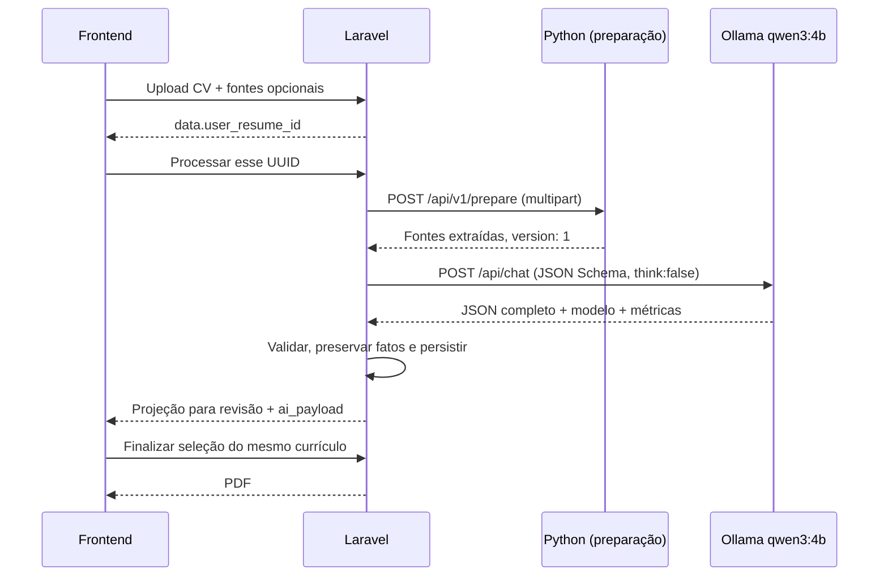

# Migração LLM para Laravel — fase 1

Verificação local em 04/11/2026. Branch: `feat/migrate-python-bot-to-laravel`.
A implementação está em commits locais; os serviços ativos não foram reconstruídos,
o banco ativo não foi migrado e não houve push, merge ou abertura de PR.

## Resultado e arquitetura

O Laravel controla seleção do driver, prompt versionado, chamada HTTP ao Ollama,
validação estrutural, integração de fatos informados, persistência, revisão e PDF.
Python continua com MarkItDown (PDF/DOCX), validação do texto e consulta ao GitHub.
O portfólio é um link/contexto, não uma página raspada. A extração não usa LLM.

O fluxo direto faz uma preparação e uma inferência, sem preflight de saúde,
retry de geração ou fallback automático. A API pública de processamento permanece
`POST /api/client/services/bot/process`. A requisição espera a resposta completa;
não foram introduzidos fila, streaming ou interface de chat.

## Qual LLM é utilizado: declaração, seleção e execução

| Evidência | Antes da migração / fluxo Python preservado | Fluxo Laravel direto desta fase |
|---|---|---|
| Declarado no código/configuração de exemplo | `provider: auto`; cadeia Groq, Gemini, DeepSeek, OpenAI, Ollama | `RESUME_GENERATION_DRIVER=ollama`, `OLLAMA_MODEL=qwen3:4b` |
| Selecionado no ambiente local inspecionado | Bot com `auto`, quatro chaves de nuvem ausentes; Ollama configurado em `http://ollama:11434` | Defaults do novo código/Compose; uma execução isolada com esses valores foi feita |
| Efetivamente comprovado em inferência | Não foi possível atribuir gerações históricas a um provedor apenas pelos logs disponíveis | Cliente Laravel recebeu `model=qwen3:4b`, `done=true`, `done_reason=stop` e currículo aprovado pelo schema |
| Não confirmado | Modelo usado anteriormente em produção e validade/disponibilidade dos modelos de nuvem declarados | Ganho comparativo de latência, qualidade em corpus representativo, capacidade sob concorrência e configuração em produção |

A execução real de teste usou dados fictícios e somente o Ollama local. Resultado:
**54,16 s**, **1.040 tokens de entrada**, **423 tokens de saída**, uma experiência,
uma formação e resumo profissional. O cliente rejeita respostas de um modelo
diferente do identificador configurado; use o nome completo com tag.

A consulta posterior `ollama ps` confirmou `qwen3:4b`, digest abreviado
`359d7dd4bcda`, **100% CPU**, contexto **16384**, aproximadamente **5,1 GB** em uso.
Antes do teste não havia modelo carregado (`/api/ps` vazio); estavam instalados
`qwen3:4b`, `qwen3:8b` e `qwen3:1.7b`. Instalação em disco, carregamento em memória
e modelo que respondeu são evidências diferentes. `keep_alive=5m` permite que
o modelo seja descarregado depois de ficar ocioso.

Esse teste exercitou o cliente/prompt/schema Laravel contra Ollama real. Não foi
um teste de navegador contra uma implantação completa reconstruída. Não foi
executado um benchmark pareado com o fluxo Python; não há ganho percentual
comprovado. A inferência em CPU permanece uma possível fonte importante de latência.

## Respostas à investigação prioritária

1. **Provedor principal:** no Python, `auto` é um seletor, não um provedor.
   Groq é a primeira preferência declarada, mas só é tentado se configurado.
   No novo caminho, Ollama é explícito e exclusivo.
2. **Modelo selecionado:** a seleção Python depende do primeiro provedor
   configurado que produzir resultado válido; no ambiente inspecionado, somente
   Ollama estava habilitado por configuração mínima. O novo cliente usa o valor
   efetivo de `config('resume.ollama.model')`, inicialmente `qwen3:4b`.
3. **`provider: auto`:** `Settings` combina YAML e variáveis de ambiente;
   `get_provider_chain()` remove duplicatas, rejeita nomes desconhecidos/cadeia
   vazia e preserva a ordem. A factory verifica configuração mínima. Isso não
   verifica conectividade, existência do modelo nem validade da credencial.
4. **Fallback Python:** `groq → gemini → deepseek → openai → ollama`, alterável
   por `IA_PROVIDER_CHAIN`. Provedores sem configuração mínima são pulados.
5. **Mudança de modelo:** no Python automático, exceções do provedor ou resultado
   fora do tipo esperado avançam para o próximo provedor configurado, até o
   deadline total. Provedor fixo não avança para os demais. Não há alternância
   automática entre tamanhos Qwen. Laravel direto só muda por configuração;
   erros retornam ao usuário e não disparam nova inferência.
6. **Docker Compose:** repassa `RESUME_GENERATION_DRIVER`, `OLLAMA_BASE_URL`,
   `OLLAMA_MODEL` e limites ao backend; o endereço padrão é `http://ollama:11434`.
   `ollama-model` baixa o modelo do mesmo `OLLAMA_MODEL`. O bot recebe os valores
   Ollama legados. Variáveis declaradas em `environment` do Compose prevalecem
   sobre `env_file`; copiar apenas `backend/.env` não substitui esses overrides.
7. **Ollama local:** confirmado, versão observada 0.33.3. O carregamento e a
   inferência real de `qwen3:4b` estão descritos acima. O estado é transitório.
8. **Desenvolvimento/produção:** há defaults de host (`127.0.0.1`) e de rede
   Docker (`ollama`, `bot`), mas não foi confirmada uma configuração LLM separada
   de produção. Não se deve inferir produção a partir do Compose local.
9. **Geração de currículos:** antes, `build_controller.py → build_resume()` usava
   a mesma seleção de provedores do scoring; mudavam prompt/schema. Agora,
   `ResumeGenerationService → OllamaResumeGenerator → OllamaClient`. `/analyze`
   Python continua disponível, sem migração de scoring independente nesta fase.
10. **Logs:** Python registra falhas/tentativas com provedor e modelo, mas não
    tinha registro explícito de sucesso com o modelo retornado. O novo cliente
    registra provedor, modelo solicitado/retornado, UUID de tentativa, currículo,
    versão do prompt, duração e tokens. O gerador mede preparação e duração total
    antes da persistência. Não registra prompt, documento ou corpo de erro Ollama.
11. **Identificação sem chamadas pagas:** configuração efetiva, presença de
    credenciais, `/api/tags`, `/api/ps` e logs permitem investigar sem inferência
    paga. Configuração e `/api/ps` não comprovam quem respondeu a uma operação
    histórica. A confirmação feita aqui foi uma geração local, sem cobrança API.
12. **Parâmetros:** tabela abaixo. O fluxo direto não usa credenciais de nuvem.
13. **Modelos declarados sem confirmação de disponibilidade:** a tabela abaixo
    lista os identificadores literalmente encontrados no YAML. As quatro chaves
    de nuvem estavam ausentes no contêiner inspecionado. Nenhuma autenticação ou
    disponibilidade remota foi testada; não houve chamada paga.
14. **Preservar/substituir:** preservar contrato canônico, idiomas, fontes,
    precedência de habilidades/links informados, validação, tratamento de erros,
    revisão e PDF. A seleção LangChain e a cadeia automática já foram substituídas
    por cliente HTTP Laravel no novo driver. Extração e GitHub ainda precisam de
    substitutos antes de remover Python; o driver legado mantém reversibilidade.

| Provedor legado | Modelo declarado no YAML | Configuração local observada |
|---|---|---|
| Groq | `openai/gpt-oss-120b` | Sem chave |
| Gemini | `gemini-3.5-flash` | Sem chave |
| DeepSeek | `deepseek-v4-flash` | Sem chave |
| OpenAI | `gpt-5.5` | Sem chave |
| Ollama | `qwen3:4b` | Endpoint configurado; modelo instalado |

`USAR_IA_PADRAO` é carregado nas settings Python, mas não governa a decisão de
inferência dos endpoints existentes. O provedor `mock` existe para testes e não
faz parte da cadeia padrão. Não foi adicionado ao caminho Laravel.

## Parâmetros e arquivos responsáveis

| Parâmetro direto | Default | Efeito |
|---|---|---|
| `RESUME_GENERATION_DRIVER` | `ollama` | `python` permite retorno explícito ao fluxo legado |
| `OLLAMA_MODEL` | `qwen3:4b` | Nome completo do modelo local |
| `RESUME_OUTPUT_LANGUAGE` | `pt-BR` | Idioma solicitado no prompt |
| `OLLAMA_TEMPERATURE` | `0.2` | Variação de geração |
| `OLLAMA_NUM_PREDICT` | `2048` | Limite de tokens gerados |
| `OLLAMA_NUM_CTX` | `16384` | Janela de contexto solicitada |
| `OLLAMA_KEEP_ALIVE` | `5m` | Retenção em memória após uso |
| `OLLAMA_CONNECT_TIMEOUT_SECONDS` | `5` | Timeout de conexão |
| `OLLAMA_TIMEOUT_SECONDS` | `240` | Timeout HTTP da inferência |
| `RESUME_PREPARE_TIMEOUT_SECONDS` | `30` | Extração + enriquecimento |
| `RESUME_MAX_SOURCE_CHARACTERS` | `30000` | Limite do JSON das fontes; excedente resulta em 422 |
| `stream`, `think` | `false`, `false` | Resposta completa, sem raciocínio separado |
| Nginx `proxy_read_timeout` | `310s` | Margem sobre preparação + inferência |

O limite de caracteres não é um contador de tokens. A adequação do contexto e
2048 tokens de saída precisa ser validada com currículos extensos. Resposta
truncada ou fora do schema resulta em 502 e não sobrescreve a análise anterior.
Modelo ausente, timeout/conexão ou erro HTTP Ollama resultam em 503. Não há retry
para tentar “reparar” JSON. Uma geração concorrente do mesmo currículo recebe 409.

No Python legado: temperatura 0.2, timeout de transporte 120 s por provedor,
deadline de inferência 240 s para a cadeia e Laravel 260 s. `num_predict=2048`
e `reasoning=false` são explícitos para Ollama; não há limite de saída universal
explícito configurado para todos os provedores de nuvem.

Arquivos principais:

- [Config Laravel](../backend/config/resume.php), [exemplo host](../backend/.env.example),
  [exemplo Docker](../.env.example), [Compose](../docker-compose.yml).
- [Seleção de driver](../backend/app/Services/Resume/ResumeGenerationService.php),
  [cliente Ollama](../backend/app/Services/Resume/OllamaClient.php),
  [gerador](../backend/app/Services/Resume/OllamaResumeGenerator.php),
  [prompt](../backend/app/Services/Resume/ResumePrompt.php),
  [schema/validação](../backend/app/Services/Resume/ResumePayload.php).
- [Preparador Laravel](../backend/app/Services/Resume/ResumeSourcePreparer.php),
  [endpoint Python](../bot/app/controllers/prepare_controller.py),
  [leitura/validação das fontes](../bot/app/controllers/resume_input.py).
- [Settings legadas](../bot/app/core/settings.py), [YAML de exemplo](../bot/config.yaml.example),
  [factory](../bot/app/providers/factory.py), [adaptador LangChain](../bot/app/providers/langchain_provider.py),
  [fallback e fatos conhecidos](../bot/app/services/ai/resume_analysis_manager.py).

O `config.yaml` do bot não estava presente no checkout host; a imagem Docker o
cria copiando `config.yaml.example`. Para executar Python fora do Docker, essa
cópia é necessária. Não foram editados arquivos `.env` com configurações reais.

## Contratos e consistência

- Contrato canônico de geração: `score`, `professional_summary`, `header`,
  `experiences`, `projects`, `qualifications`, `skills`, `languages`, `others`.
  O schema PHP e a fixture compartilhada são verificados também contra Pydantic.
- O payload gerado é preservado em `ai_payload`; a projeção de revisão leva
  resumo para `header.summary` e nota para `others.score`. Payloads legados com
  `personal/education/courses` têm projeção compatível sem migração destrutiva.
  Campos revisados, incluindo listas vazias, prevalecem sobre a projeção.
- Upload retorna `data.user_resume_id`. O frontend usa esse UUID diretamente;
  não consulta mais o “currículo mais recente” para descobrir qual processar.
- Novos uploads persistem `user_resumes.source_context` com links/habilidades
  daquele envio. Registros antigos sem snapshot mantêm o fallback ao perfil.
  Arquivos ainda referenciados por currículos anteriores são preservados.
- A correção da condição de sincronização permite salvar uma única habilidade;
  anos de experiência novos são inteiros não negativos, compatíveis com Python.
- Finalização valida proprietário e correspondência entre UUID da rota e corpo.
  Resumo e score são preservados ao aplicar a seleção; listas excluídas não são
  repostas pelo payload bruto. PDF aceita dados opcionais/legados e nomes de
  arquivo usam UUID para evitar colisões.
- A geração usa lock por currículo. Em múltiplas instâncias, configure um cache
  compartilhado que suporte locks (o cache file local não coordena hosts distintos).

## Ativação e retorno ao fluxo legado

1. Aplicar a migration `2026_11_04_000000_add_source_context_to_user_resumes.php`
   no ambiente de destino antes de servir o novo código. Nos testes ela foi
   aplicada apenas ao SQLite em memória. O entrypoint Docker atual já executa
   migrations e seeds; revisar esse comportamento no processo de implantação.
2. Reconstruir bot, backend e frontend para entregar `/prepare`, cliente Laravel
   e contrato de upload juntos. Confirmar a presença de `qwen3:4b` no Ollama.
3. Usar as variáveis de exemplo com `RESUME_GENERATION_DRIVER=ollama` e endereços
   acessíveis pelo backend. Fora do Docker, preparar `bot/config.yaml` e apontar
   `BOT_URL`/`OLLAMA_BASE_URL` para os serviços corretos.
4. Atualizar/limpar cache de configuração Laravel ao trocar variáveis. Confirmar
   uma geração e os logs de provedor/modelo no ambiente de destino.
5. Para retorno operacional, definir `RESUME_GENERATION_DRIVER=python` na origem
   efetiva da configuração e atualizar o cache/reiniciar o processo. O schema
   aditivo pode permanecer. Esse modo reativa a cadeia Python, inclusive
   provedores de nuvem caso existam credenciais; não é um fallback automático.

Esses passos são instruções de implantação; não foram executados nos serviços ativos.
O Ollama usado na validação já estava instalado. Não foram baixados modelos novos.

## Validação e pendências

- Backend: **258 testes**, **977 assertions**, PHP 8.4, dependências da imagem
  existente, SQLite em memória, storage/cache temporários, sem rede na suíte.
- Pint: **146 arquivos aprovados**.
- Python: **90 testes**, dependências da imagem existente e pytest em `/tmp`,
  cópia temporária com `config.yaml.example`, sem rede. Um warning preexistente
  de depreciação de `pythonjsonlogger.jsonlogger`.
- Frontend: **37 testes**, lint e build TypeScript/Vite aprovados. Permanecem os
  avisos de configuração nativa futura do Vite (`__dirname`) e bundle >500 kB.
- `docker compose config --quiet` e `git diff --check` aprovados.
- Inferência real local: resultado descrito acima; dados fictícios, sem API paga.

Próximas etapas: implantar e validar o fluxo completo; medir p50/p95, carga fria/
quente e qualidade com corpus representativo; dimensionar contexto/saída e CPU/GPU;
avaliar fila e streaming; substituir extração/validação/GitHub antes da remoção
Python. O servidor PHP do Compose ainda é `artisan serve`, e parsing Python
continua síncrono durante extração; ambos merecem avaliação sob concorrência.
Arquivos antigos já apagados pelo comportamento anterior não são recuperados.

Referências do protocolo: [Ollama Chat](https://docs.ollama.com/api/chat) e
[Structured Outputs](https://docs.ollama.com/capabilities/structured-outputs).
