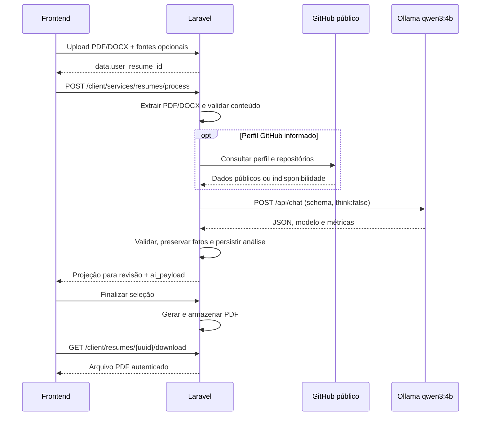

# Processamento de currículos no Laravel

Migração concluída na branch `feat/migrate-python-bot-to-laravel`, em 05/11/2026.
O aplicativo não depende mais de Python. O histórico Git preserva a implementação
anterior; não existe driver de retorno automático ao bot.

## Arquitetura e funcionalidades



| Responsabilidade | Implementação atual |
|---|---|
| PDF, incluindo exportação LinkedIn | `PdfTextReader`: Poppler `pdftotext`, processo local com timeout e limite de saída |
| DOCX | `DocxTextReader`: PHP ZipArchive + DOM, texto, tabelas, cabeçalhos, rodapés, notas e hyperlinks |
| Validação do conteúdo | `ResumeContentValidator`: texto não vazio, tamanho mínimo e diversidade de palavras |
| Fontes do envio | `ResumeSourcePreparer`: snapshot do currículo; fallback ao perfil para registros antigos |
| Enriquecimento GitHub | `GitHubProfileFetcher`: API oficial, perfil público e até seis repositórios próprios |
| Geração | `OllamaResumeGenerator`, `ResumePrompt`, `OllamaClient`, `ResumePayload` |
| Nota e sugestão independentes | `ResumeScorer`, `ResumeScorePrompt`, `ResumeScorePayload` |
| Persistência e compatibilidade | `ResumeAnalysisPersister`, `ResumeProjection`, `LegacyResumePayload` |
| Revisão e PDF | Fluxo existente de finalização e `ResumeDocumentService` |

O GitHub é opcional: falhas, limite de requisições ou perfil inexistente não impedem
a geração. O endpoint é fixo em `api.github.com`; URLs de usuários não são baixadas
arbitrariamente. O portfólio continua sendo um link/contexto, sem scraping.
PDFs compostos apenas por imagens precisam de OCR, que não fazia parte do fluxo
anterior e não foi acrescentado. Arquivos inválidos, muito grandes ou sem conteúdo
suficiente retornam 422 antes da inferência.

O DOCX é lido sem extrair arquivos no disco e sem carregar DTDs, entidades externas
ou recursos remotos. Há limites de tamanho descompactado e quantidade de entradas.
Nenhuma chamada a LLM é necessária para a extração ou para a consulta ao GitHub.

## API e dados existentes

Todos os caminhos abaixo têm prefixo `/api` e exigem a autenticação existente:

- `POST /client/resumes/new-resume`: upload; retorna `data.user_resume_id`.
- `POST /client/services/resumes/process`: corpo `{ "user_resume_id": "UUID" }`.
- `POST /client/services/bot/process`: alias de compatibilidade para o mesmo controller Laravel.
- `POST /client/resumes/{uuid}/score`: retorna `data.score` e `data.suggestion`,
  sem reescrever o currículo, a análise ou seu estado.
- `POST /client/resumes/{uuid}/finish`: revisão/finalização existente.
- `GET /client/resumes/{uuid}/download`: entrega o PDF armazenado, validando propriedade.

O frontend passou a utilizar a rota canônica `services/resumes/process`. A rota
antiga permanece para clientes ainda não atualizados; seu nome não representa
uma dependência do bot. Os endpoints internos antigos na porta 8000 foram retirados.
O antigo `/api/v1/analyze` foi substituído funcionalmente pelo endpoint autenticado
`/api/client/resumes/{uuid}/score`, após o upload do documento.

O contrato canônico continua incluindo `score`, `professional_summary`, `header`,
`experiences`, `projects`, `qualifications`, `skills`, `languages` e `others`.
`ai_payload` preserva a resposta validada; a projeção mantém resumo e nota para
revisão. Dados antigos com `personal/education/courses` permanecem legíveis.
Listas explicitamente excluídas na revisão não são repostas pelo payload original.
Links e habilidades informados pelo usuário prevalecem sobre sugestões da IA.

Não há migration destrutiva ou alteração de IDs nesta etapa. A migration aditiva
`2026_11_04_000000_add_source_context_to_user_resumes.php`, da fase anterior,
continua necessária para instalações ainda não atualizadas. Arquivos e volumes
existentes são mantidos. Arquivos apagados antes da migração não são recuperáveis.

## Provedor e parâmetros

O único provedor de inferência é Ollama. `AppServiceProvider` vincula a interface
`ResumeGenerator` a `OllamaResumeGenerator`. O modelo declarado e o default do
Compose são `qwen3:4b`; a seleção efetiva vem de `config('resume.ollama.model')`.
O cliente verifica o nome retornado pelo Ollama e exige uma resposta completa.
Não existe `provider: auto`, cadeia de provedores de nuvem ou fallback silencioso.

| Variável / limite | Default |
|---|---|
| `OLLAMA_BASE_URL` fora do Docker / no Compose | `http://127.0.0.1:11434` / `http://ollama:11434` |
| `OLLAMA_MODEL` | `qwen3:4b` |
| `RESUME_OUTPUT_LANGUAGE` | `pt-BR` |
| `OLLAMA_TEMPERATURE` | `0.2` |
| `OLLAMA_NUM_PREDICT` | 2048 tokens de saída |
| `OLLAMA_NUM_CTX` | 16384 tokens de contexto |
| `OLLAMA_KEEP_ALIVE` | `5m` |
| `OLLAMA_CONNECT_TIMEOUT_SECONDS` / `OLLAMA_TIMEOUT_SECONDS` | 5 / 240 segundos |
| `PDFTOTEXT_BINARY` | `/usr/bin/pdftotext` |
| `RESUME_DOCUMENT_TIMEOUT_SECONDS` | 10 segundos por processo PDF |
| `GITHUB_TIMEOUT_SECONDS` | 10 segundos por requisição, até duas |
| `GITHUB_TOKEN` | Opcional, em `backend/.env`; não precisa de credenciais de LLM |
| `RESUME_MAX_SOURCE_CHARACTERS` | 30000 caracteres do JSON das fontes |
| Limite por documento / XML DOCX / texto extraído | 10 MiB / 16 MiB / 256 KiB |
| Entradas no ZIP DOCX | Até 2048 |
| `stream` / `think` | `false` / `false` |
| Nginx `proxy_read_timeout` | 310 segundos |

Os limites internos de extração estão em `backend/config/resume.php`. O limite
HTTP de upload também depende de PHP e Nginx. O Compose define as variáveis de
inferência na seção `environment`, que prevalece sobre `backend/.env`; altere a
`.env` da raiz para esses valores. Fora do Docker, use `backend/.env`.

Modelo indisponível, conexão ou timeout retornam 503; resposta truncada, modelo
inesperado ou schema inválido retornam 502. A análise anterior não é sobrescrita
por uma geração inválida. Operações simultâneas do mesmo currículo recebem 409.
Em múltiplas instâncias, configure um cache compartilhado com suporte a locks.

## Execução e acompanhamento

Para uma instalação nova, copie `.env.example`, `backend/.env.example` e
`frontend/.env.example` para os respectivos arquivos `.env`. Em instalações
existentes, preserve credenciais e parâmetros já configurados.

```bash
docker compose up -d --build
docker compose ps
docker compose exec ollama ollama list
docker compose exec ollama ollama ps
docker compose logs -f backend
```

O Compose contém PostgreSQL, Ollama, inicializador do modelo, backend e frontend.
O inicializador baixa o modelo se necessário. O backend aguarda PostgreSQL saudável
e a conclusão da preparação do modelo. Frontend: `http://localhost:5173`;
backend: `http://localhost:9000`; saúde do backend: `/up`.

Em uma instalação antiga, remova o contêiner do bot depois de validar o novo fluxo:

```bash
docker stop bomcurriculo-bot-1
docker rm bomcurriculo-bot-1
```

Não remova os volumes `postgres_data`, `backend_storage` ou `ollama_data`.
As variáveis `BOT_*`, `RESUME_GENERATION_DRIVER`, `RESUME_PREPARE_TIMEOUT_SECONDS`
e `OLLAMA_REASONING` não são mais utilizadas. Se existia `GITHUB_TOKEN` no ambiente
do bot, transfira seu valor para `backend/.env` antes de excluir esse ambiente.

Fora do Docker, instale PHP 8.4 com extensões exigidas pelo Composer, incluindo
DOM, mbstring e ZIP, e Poppler (`poppler-utils` no Debian/Ubuntu). Configure o
caminho de `pdftotext` se necessário. Não é necessário instalar Python, uv,
MarkItDown, LangChain, Quart ou Hypercorn.

Os logs `Resume generation completed.` e `Resume score completed.` registram
provedor, modelo solicitado/retornado, duração, tokens, versão do prompt e IDs de
correlação. `Resume sources and generation completed.` inclui preparação e duração do pipeline
antes da persistência. Documentos, prompts e segredos não são registrados.
`ollama list` indica instalação; `ollama ps`, carregamento. Apenas o log de uma
operação bem-sucedida identifica o modelo que respondeu àquela operação.

## Testes reproduzíveis

Após o build, estes comandos utilizam um contêiner descartável, SQLite em memória
e o storage interno desse contêiner, sem montar volumes da aplicação:

```bash
docker run --rm --network none \
  -e APP_ENV=testing -e APP_KEY=base64:AAAAAAAAAAAAAAAAAAAAAAAAAAAAAAAAAAAAAAAAAAA= \
  -e DB_CONNECTION=sqlite -e DB_DATABASE=:memory: -e DB_URL= \
  -e CACHE_STORE=array -e SESSION_DRIVER=array -e LOG_CHANNEL=null \
  --entrypoint sh bomcurriculo-backend \
  -c 'touch .env && php vendor/bin/pest --compact'
```

Teste opt-in de PDF e DOCX com Ollama local real, chegando ao download do PDF:

```bash
docker run --rm --network bomcurriculo_bomcurriculo \
  -e APP_ENV=testing -e APP_KEY=base64:AAAAAAAAAAAAAAAAAAAAAAAAAAAAAAAAAAAAAAAAAAA= \
  -e DB_CONNECTION=sqlite -e DB_DATABASE=:memory: -e DB_URL= \
  -e CACHE_STORE=array -e SESSION_DRIVER=array -e LOG_CHANNEL=null \
  -e RUN_OLLAMA_INTEGRATION=1 -e OLLAMA_BASE_URL=http://ollama:11434 \
  --entrypoint sh bomcurriculo-backend \
  -c 'touch .env && php vendor/bin/pest tests/Feature/Resume/LiveOllamaFlowTest.php --compact'
```

Os testes usam currículos fictícios. O teste real restringe chamadas HTTP ao Ollama
local. Enriquecimento GitHub, falhas e limites são cobertos com respostas simuladas;
a suíte determinística cobre PDF/DOCX, LinkedIn, GitHub, geração, revisão e download.
Ela também cobre payloads antigos, autorização, locks, arquivos malformados e
proteções do parser. Não são realizadas chamadas pagas.

Frontend: execute `npm test`, `npm run lint` e `npm run build` em `frontend/`.
Estilo PHP: `vendor/bin/pint --test` no ambiente PHP 8.4.

## Validação desta migração

- Backend: 257 testes aprovados, 765 assertions; os dois testes reais ficam
  desabilitados na suíte padrão e foram executados separadamente.
- Ollama real, com o bot desligado: 2 testes aprovados, 18 assertions. Entrada PDF:
  68,01 segundos; entrada DOCX: 48,17 segundos. Ambos percorreram upload, extração,
  geração, revisão, finalização e download de um PDF válido. Modelo `qwen3:4b`, CPU.
- Frontend: 40 testes aprovados; ESLint, TypeScript e build Vite aprovados.
- Pint: 160 arquivos aprovados. Configuração do Compose validada sem serviço bot.
- A suíte de 257 testes também passou na imagem final reconstruída, sem rede,
  volumes da aplicação ou dependência de arquivos `.env` locais.
- Backend e frontend foram reconstruídos e iniciados. PostgreSQL, Ollama,
  backend e frontend estão saudáveis; o inicializador do modelo concluiu sua tarefa.
  O contêiner antigo do bot foi removido. A imagem ativa do backend contém
  `pdftotext` e não contém os executáveis `python` ou `python3`.
- Verificação HTTP local: frontend e `/up` retornaram 200; a rota de processamento
  pelo proxy retornou 401 sem autenticação, conforme esperado.
- Consulta real e sem token à API pública do GitHub: perfil de exemplo aceito e
  seis repositórios retornados pelo novo serviço Laravel.
- `composer validate --no-check-publish` aprovado, com o aviso preexistente de
  versão irrestrita (`*`) em `kreait/firebase-php`.

Os tempos medem o fluxo completo com currículos fictícios e não constituem um
benchmark comparativo com a arquitetura antiga. O banco ativo não recebeu os
dados dos testes: as execuções usaram SQLite em memória e storage temporário.

## Limites e próximos passos

- A geração continua síncrona. Ollama em CPU pode demorar; remover o serviço
  Python não elimina o custo da inferência. Avaliar fila, concorrência, GPU e
  qualidade com currículos representativos é uma etapa distinta.
- Caracteres não equivalem a tokens. Contexto e saída devem ser dimensionados
  com documentos extensos; não há truncamento silencioso para caber nos limites.
- O Compose utiliza `artisan serve` para desenvolvimento. Uma implantação de
  produção precisa dimensionar servidor PHP, workers, cache e armazenamento.
- Os testes HTTP do Laravel percorrem os controllers e o pipeline; não equivalem
  a uma sessão automatizada de navegador nem a um teste de carga.
- Permanecem avisos preexistentes do frontend sobre bundle acima de 500 kB e a
  futura configuração nativa do Vite. A revisão de dependências deve ser tratada
  separadamente; esta migração não atualizou versões de pacotes existentes.
- `composer audit --locked` identificou 29 avisos de segurança em 10 dependências
  preexistentes: Guzzle, Laravel, CommonMark, Flysystem, phpseclib e componentes
  Symfony (HttpFoundation, HttpKernel, Mime, Routing e Yaml). A atualização e
  validação dessas dependências permanece pendente antes de uma publicação.
